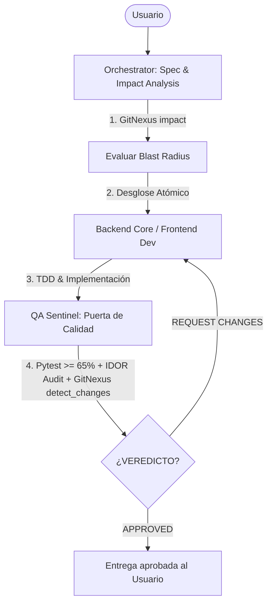

<!-- gitnexus:start -->
# GitNexus — Code Intelligence

This project is indexed by GitNexus as **prioritask** (908 symbols, 2071 relationships, 69 execution flows).

> Index stale? Run `node .gitnexus/run.cjs analyze --index-only` from the project root — it auto-selects an available runner. No `.gitnexus/run.cjs` yet? Bootstrap with `npx`, `bunx`, or `pnpm dlx` — e.g. `bunx gitnexus@latest analyze` (npm 11 npx crash; #1939).

## Always Do

- **MUST work on a dedicated branch.** Never commit or work directly on `main`. Always create or switch to a descriptive branch (e.g. `feature/*`, `refactor/*`, `fix/*`) before modifying any code or database state. Verify active branch with `git branch --show-current`.
- **MUST run impact analysis before editing.** Use `impact({target: "symbolName", direction: "upstream"})` (MCP) or `node .gitnexus/run.cjs impact "symbolName" --direction upstream --repo .` (CLI fallback); report callers, processes, and risk. Never substitute grep for graph analysis.
- **MUST analyze graph changes before committing.** Use `detect_changes({scope: "all"})` (MCP) or `node .gitnexus/run.cjs detect-changes --scope all --repo .` (CLI fallback). `partial: true` or `truncated: true` is not a clean check — a zero means unseen, not unaffected; re-run it. For regression review: `detect_changes({scope: "compare", base_ref: "main"})` or `node .gitnexus/run.cjs detect-changes --scope compare --base-ref "main" --repo .`.
- **MUST warn the user** if impact analysis returns HIGH or CRITICAL risk before proceeding with edits.
- **MUST treat `risk: UNKNOWN` as unresolved, not as low.** An empty caller set is not evidence the symbol is unused — it can also mean the callers are not resolvable by the index (plain-object property access, dynamic dispatch, cross-language calls). `impact` pairs `UNKNOWN` with a `riskNote` saying so. Confirm with a text search before treating the symbol as safe to change or delete; do not proceed on the strength of a zero.
- When exploring unfamiliar code, use `query({search_query: "concept"})` to find execution flows instead of grepping. It returns process-grouped results ranked by relevance.
- When you need full context on a specific symbol — callers, callees, which execution flows it participates in — use `context({name: "symbolName"})`.
- For security review, `explain({target: "fileOrSymbol"})` lists taint findings (source→sink flows; needs `analyze --pdg`).

## Never Do

- NEVER work or commit directly on the `main` branch. All work must be conducted on a dedicated feature, fix, or refactor branch.
- NEVER edit a function, class, or method before MCP/CLI impact analysis.
- NEVER ignore HIGH or CRITICAL risk warnings from impact analysis, and never read `UNKNOWN` as an all-clear — it means the walk could not answer, which is the one verdict that requires confirming by other means.
- NEVER rename symbols with find-and-replace — use `rename` which understands the call graph.
- NEVER commit before MCP/CLI graph change analysis.

## Resources

| Resource | Use for |
| --- | --- |
| `gitnexus://repo/prioritask/context` | Codebase overview, check index freshness |
| `gitnexus://repo/prioritask/clusters` | All functional areas |
| `gitnexus://repo/prioritask/processes` | All execution flows |
| `gitnexus://repo/prioritask/process/{name}` | Step-by-step execution trace |

## CLI

| Task | Read this skill file |
| --- | --- |
| Understand architecture / "How does X work?" | `.claude/skills/gitnexus-exploring/SKILL.md` |
| Blast radius / "What breaks if I change X?" | `.claude/skills/gitnexus-impact-analysis/SKILL.md` |
| Trace bugs / "Why is X failing?" | `.claude/skills/gitnexus-debugging/SKILL.md` |
| Rename / extract / split / refactor | `.claude/skills/gitnexus-refactoring/SKILL.md` |
| Tools, resources, schema reference | `.claude/skills/gitnexus-guide/SKILL.md` |
| Index, status, clean, wiki CLI commands | `.claude/skills/gitnexus-cli/SKILL.md` |

<!-- gitnexus:end -->

---

# Prioritask — Equipo de Agentes y Calidad de Producción

Este proyecto sigue el framework de ingeniería de producción de **Agent Skills** estructurado en roles especializados coordinados y gobernados por **GitNexus** y un **Quality Gate Innegociable**:

## 1. El Equipo de Agentes (`.agents/agents/`)

| Agente | Archivo | Rol y Responsabilidad Principal | Skills Clave |
|---|---|---|---|
| **Orchestrator** | [orchestrator.md](file:///.agents/agents/orchestrator.md) | Tech Lead / Arquitecto. Descompone tareas, evalúa impacto con GitNexus, asigna tareas y coordina entregas. Jamás edita código directamente. | `spec-driven-development`, `planning-and-task-breakdown`, `interview-me`, `gitnexus-impact-analysis` |
| **Backend Core** | [backend-core.md](file:///.agents/agents/backend-core.md) | Ingeniero Backend. Endpoints FastAPI, modelos SQLite (WAL), asincronía total, contratos Pydantic y tests unitarios. | `api-and-interface-design`, `incremental-implementation`, `test-driven-development`, `code-simplification` |
| **Frontend Dev** | [frontend-dev.md](file:///.agents/agents/frontend-dev.md) | Ingeniero Frontend. UI/UX en React 19, TypeScript estricto (cero `any`), clientes Axios centralizados y accesibilidad. | `frontend-ui-engineering`, `modern-web-guidance`, `code-simplification`, `browser-testing-with-devtools` |
| **QA Sentinel** | [qa-sentinel.md](file:///.agents/agents/qa-sentinel.md) | **Puerta de Calidad y Seguridad (Gatekeeper)**. Cobertura >=65%, auditoría IDOR/Auth, escaneo de linting y verificación de grafo en GitNexus. | `code-review-and-quality`, `security-and-hardening`, `test-driven-development`, `debugging-and-error-recovery` |
| **Code Reviewer** | [code-reviewer.md](file:///.agents/agents/code-reviewer.md) | Revisor Senior en 5 dimensiones (Correctitud, Legibilidad, Arquitectura, Seguridad y Rendimiento). | `code-review-and-quality`, `code-simplification`, `gitnexus-impact-analysis` |
| **Security Auditor** | [security-auditor.md](file:///.agents/agents/security-auditor.md) | Auditor de Seguridad. Detección de vulnerabilidades OWASP, modelado de amenazas y mitigación. | `security-and-hardening`, `gitnexus-exploring` |

---

## 2. Protocolo de Ciclo de Vida y Quality Gate

Toda funcionalidad, corrección o cambio debe seguir el siguiente flujo ininterrumpido:

### Reglas Innegociables de Calidad
1. **Impacto Primero:** Antes de modificar un símbolo existente, ejecutar análisis de impacto de GitNexus.
2. **Quality Gate Obligatorio:** Ninguna tarea se da por concluida sin el veredicto explícito `VERDICT: APPROVED` emitido por `qa-sentinel`.
3. **Control de Acceso e IDOR:** Cada consulta a la base de datos debe validar de manera estricta el usuario/hogar solicitante.
4. **Verificación de Grafo:** El Gatekeeper siempre valida que `detect_changes({scope: "all"})` no presente regresiones ni roturas no autorizadas.

