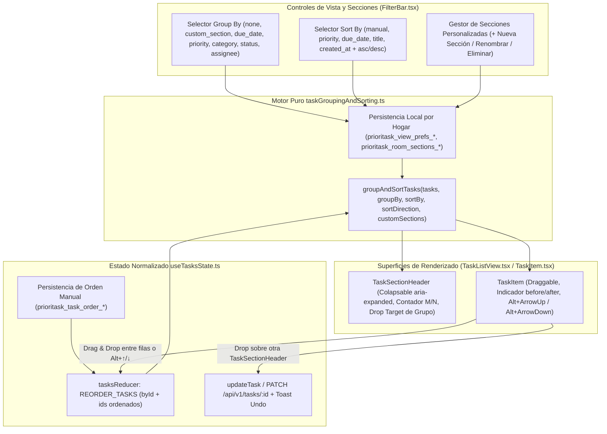

# Especificación Técnica y Funcional (`SPEC.md`)

---

## Índice General y Resumen Consolidado de las 4 Funcionalidades Completadas (Ingeniería Inversa Basada en Evidencia — REA Todoist v9.31.0)

| # | Funcionalidad | Módulos y Componentes Clave | Pruebas Unitarias e Integración | Estado y Veredicto QA |
| :--- | :--- | :--- | :--- | :--- |
| **#1** | **Captura Rápida Global (`GlobalQuickAddModal`) y Parser NLP Enriquecido (`@tags`, `~sala`, `+asignado`)** | [`nlpTaskParser.ts`](file:///c:/Users/jarsa/Documents/antigravity/prioritask/prioritask-frontend/src/utils/nlpTaskParser.ts), [`GlobalQuickAddModal.tsx`](file:///c:/Users/jarsa/Documents/antigravity/prioritask/prioritask-frontend/src/components/tasks/GlobalQuickAddModal.tsx), [`QuickAddTaskBar.tsx`](file:///c:/Users/jarsa/Documents/antigravity/prioritask/prioritask-frontend/src/components/tasks/QuickAddTaskBar.tsx), [`TaskForm.tsx`](file:///c:/Users/jarsa/Documents/antigravity/prioritask/prioritask-frontend/src/components/TaskForm.tsx), [`App.tsx`](file:///c:/Users/jarsa/Documents/antigravity/prioritask/prioritask-frontend/src/App.tsx) | [`nlpTaskParser.test.ts`](file:///c:/Users/jarsa/Documents/antigravity/prioritask/prioritask-frontend/src/utils/__tests__/nlpTaskParser.test.ts), [`GlobalQuickAddModal.test.tsx`](file:///c:/Users/jarsa/Documents/antigravity/prioritask/prioritask-frontend/src/components/tasks/__tests__/GlobalQuickAddModal.test.tsx), [`QuickAddTaskBar.test.tsx`](file:///c:/Users/jarsa/Documents/antigravity/prioritask/prioritask-frontend/src/components/tasks/__tests__/QuickAddTaskBar.test.tsx) | `COMPLETADA Y APROBADA (VERDICT: APPROVED)` |
| **#2** | **Subsistema de Selección Múltiple (`selectedTaskIds`), Barra Flotante de Acciones en Lote (`TaskBulkActionsBar`), Pospuesto Rápido (`Snooze`) y Deshacer (`Undo`) Atómico** | [`useTasksState.ts`](file:///c:/Users/jarsa/Documents/antigravity/prioritask/prioritask-frontend/src/hooks/useTasksState.ts), [`TaskBulkActionsBar.tsx`](file:///c:/Users/jarsa/Documents/antigravity/prioritask/prioritask-frontend/src/components/tasks/TaskBulkActionsBar.tsx), [`TaskItem.tsx`](file:///c:/Users/jarsa/Documents/antigravity/prioritask/prioritask-frontend/src/components/tasks/TaskItem.tsx), [`TaskList.tsx`](file:///c:/Users/jarsa/Documents/antigravity/prioritask/prioritask-frontend/src/components/TaskList.tsx), [`RoomTasks.tsx`](file:///c:/Users/jarsa/Documents/antigravity/prioritask/prioritask-frontend/src/pages/RoomTasks.tsx) | [`useTasksState.bulk.test.ts`](file:///c:/Users/jarsa/Documents/antigravity/prioritask/prioritask-frontend/src/hooks/__tests__/useTasksState.bulk.test.ts), [`TaskBulkActionsBar.test.tsx`](file:///c:/Users/jarsa/Documents/antigravity/prioritask/prioritask-frontend/src/components/tasks/__tests__/TaskBulkActionsBar.test.tsx) | `COMPLETADA Y APROBADA (VERDICT: APPROVED)` |
| **#3** | **Motor de Navegación Estructurada (`navigateTo`), Vistas Inteligentes (`Hoy` / `Próximo` / `Completado`), Deep-Linking de Tareas (`?taskId=`) y Paleta de Comandos Accionable (`CommandPaletteModal`)** | [`navigationRouter.ts`](file:///c:/Users/jarsa/Documents/antigravity/prioritask/prioritask-frontend/src/utils/navigationRouter.ts), [`CommandPaletteModal.tsx`](file:///c:/Users/jarsa/Documents/antigravity/prioritask/prioritask-frontend/src/components/common/CommandPaletteModal.tsx), [`Sidebar.tsx`](file:///c:/Users/jarsa/Documents/antigravity/prioritask/prioritask-frontend/src/components/Sidebar.tsx), [`FilterBar.tsx`](file:///c:/Users/jarsa/Documents/antigravity/prioritask/prioritask-frontend/src/components/tasks/FilterBar.tsx) | [`navigationRouter.test.ts`](file:///c:/Users/jarsa/Documents/antigravity/prioritask/prioritask-frontend/src/utils/__tests__/navigationRouter.test.ts), [`CommandPaletteModal.test.tsx`](file:///c:/Users/jarsa/Documents/antigravity/prioritask/prioritask-frontend/src/components/common/__tests__/CommandPaletteModal.test.tsx) | `COMPLETADA Y APROBADA (VERDICT: APPROVED)` |
| **#4** | **Agrupación Dinámica de Vistas (`Group By` / `Sort By`), Secciones Personalizadas por Hogar y Ordenación Manual (`Drag & Drop` / Teclado `Alt+↑`/`Alt+↓`)** | [`taskGroupingAndSorting.ts`](file:///c:/Users/jarsa/Documents/antigravity/prioritask/prioritask-frontend/src/utils/taskGroupingAndSorting.ts), [`TaskListView.tsx`](file:///c:/Users/jarsa/Documents/antigravity/prioritask/prioritask-frontend/src/components/tasks/TaskListView.tsx), [`FilterBar.tsx`](file:///c:/Users/jarsa/Documents/antigravity/prioritask/prioritask-frontend/src/components/tasks/FilterBar.tsx), [`TaskItem.tsx`](file:///c:/Users/jarsa/Documents/antigravity/prioritask/prioritask-frontend/src/components/tasks/TaskItem.tsx), [`useTasksState.ts`](file:///c:/Users/jarsa/Documents/antigravity/prioritask/prioritask-frontend/src/hooks/useTasksState.ts) | [`taskGroupingAndSorting.test.ts`](file:///c:/Users/jarsa/Documents/antigravity/prioritask/prioritask-frontend/src/utils/__tests__/taskGroupingAndSorting.test.ts), [`TaskListView.grouping.test.tsx`](file:///c:/Users/jarsa/Documents/antigravity/prioritask/prioritask-frontend/src/components/tasks/__tests__/TaskListView.grouping.test.tsx) | `COMPLETADA Y APROBADA (VERDICT: APPROVED)` |

### Métricas Globales de Verificación y Calidad (`qa-sentinel`)
- **Suite de Pruebas Frontend (`vitest`):** **10 suites de Vitest (`56/56 tests PASS`)**.
- **Análisis Estático y Tipado (`npm run lint`):** `0 errores`, `0 advertencias`, cero uso de `any`.
- **Compilación de Producción (`npm run build`):** `0 errores` (`tsc -b && vite build`, `261 módulos` transformados).
- **Integridad de Grafo (`GitNexus`):** `0` regresiones, alcance controlado y 100% alineado con las especificaciones.

---

# FUNCIONALIDAD #4 (COMPLETADA)
## Agrupación Dinámica de Vistas (`Group By` / `Sort By`), Secciones Personalizadas por Hogar y Ordenación Manual (`Drag & Drop` / Teclado)

- **Proyecto:** Prioritask
- **Rama de Trabajo:** `feature/global-quick-add` (Consolidación de Funcionalidades #1 a #4)
- **Estado:** Fase 5 — Completada, Verificada y Aprobada (VERDICT: APPROVED)
- **Referencia de Ingeniería Inversa (REA):** Todoist Desktop `v9.31.0` (`Todoist-win32-9.31.0-latest`)

---

## 1. Resumen Ejecutivo y Trazabilidad de Evidencias (REA — Fase 2)

Esta especificación define el diseño funcional, las reglas de negocio y la arquitectura técnica para incorporar en **Prioritask** el **Motor de Agrupación Dinámica de Vistas (`Group By`) y Ordenación Configurable (`Sort By`)**, el sistema de **Secciones Personalizadas por Hogar con Cabeceras Colapsables (`TaskSectionHeader`) y Mutación por Arrastre entre Grupos (`Cross-Group Drop`)**, y la **Ordenación Manual Persistente (`REORDER_TASKS`) mediante `Drag & Drop` y Teclado Accesible (`Alt+↑` / `Alt+↓`)**.

El diseño se fundamenta en el diagnóstico del repositorio de Prioritask (**Fase 1**) y en la ingeniería inversa basada en evidencia (**Fase 2 — REA**) sobre el artefacto de producción **Todoist Desktop v9.31.0 (`Todoist-win32-9.31.0-latest`)**.

### 1.1 Artefactos y Evidencias Registradas en REA

| Identificador | Tipo de Recurso | Detalle Técnico y Hash SHA-256 |
| :--- | :--- | :--- |
| `Todoist-win32-9.31.0-latest` | Artefacto Primario (`app.asar`) | Ruta: `resources/app.asar` — SHA-256: `5d75687118115452fda7796be58da3eae0a4ba4d8a8d6601452ac80d79f8947e` |
| `webpack/electron/electron.js` | Bundle Principal Electron | SHA-256: `6590b073287f470f948ee3783a4883fbaeeba0882a957765c5a843529e1cdfbe` |
| `webpack/todoist-main-preload/preload.js` | Bundle Preload Ventana Principal | SHA-256: `ad44cef107bd0b9e7ba1b6f0573b45861a33642451d278f3da8204475f040f0d` |
| `ev_024d8eae48e7768fceb0e6a9e6d07f90f84a5a4ce210f7c64cfde7000ae9f79f` | Evidencia REA (`analyze_javascript_application`) | Análisis de aplicación JavaScript sobre `resources/app.asar` |
| `ev_f3421dd1cf1abb8044a66f6b2d7b3dd49756f0ab9224b2fa35424d1d3fd1000e` | Evidencia REA (`analyze_javascript_application`) | Análisis de correlación de módulos y puentes IPC sobre `webpack/` |
| `ev_c8e9db063400aad9e27c197dd8eb32a05908c94da7433a6fc5753758e95f4172` | Evidencia REA (`trace_application_feature`) | Traza `jatr_50048ecce0b8ba865cffc6e2d5e481b0a62d7757f88bf74ac3fa23fec872ef14` sobre `setTrayMenuItems` (nodos `jag_node_8e6f46ad0149249e4c002118b77ca8ce5eaf314e07329111734f7c273dc21df7` y `jag_node_aa1fff2173d5d3df742dd5c4a020500b6727dc4021cd5d9aaaaaebcd49ec620f`) |
| `ev_7b83bd1c65680499c5e6271a526ca98e5a5e016be40b53d42f30675bbe2441b5` | Evidencia REA (`trace_application_feature`) | Traza `jatr_aa822e2849d0698477396a4972b08f9a2c6dfc95b3b36861e40391048842dc35` sobre `setFavourites` (nodos `jag_node_37587f4973f94c9badc2d58a5f0ef601f4b0800495300236dfdc0114e299571f` y `jag_node_6a52011f0ffae732b4e9c20c9cc547479e27cdf5f4252c7b16da8e06ca60ba06`) |
| `ev_e4c4d9dc3587401d46800f0c092a06a99466be93ce808614b526d34919380eab` | Evidencia REA (`trace_application_feature`) | Traza `jatr_77c76689fbff043a2ae5441654fbc52db948863f6babca2fdec0aafdcd082f6b` sobre `setProductivityWidgetData` (nodo `jag_node_1a9f3e1fc5e57ad2b393c8881075fb697a873dff4d2eacfd25885b92c01d2868`) |
| `ev_dae11bf92d17462241bf9a45cf0216b7939dd2c4ee39c323390db04c6a3c7106` | Evidencia REA (`trace_application_feature`) | Traza `jatr_51446a6b222fab8169a700750c4ed64cfcd306eea9f18d93a676ace7c29085fe` sobre `setWorkspaces` (nodo `jag_node_0264604241561904d52d0b73c3e108d63eef8f78f9cf978b0b8828fe8d667555`) |

### 1.2 Matriz de Clasificación Epistemológica: Confirmado vs. Inferido vs. Incógnita

| Categoría | Elemento / Símbolo | Evidencia y Localización Exacta | Descripción Técnica |
| :--- | :--- | :--- | :--- |
| **Confirmado (Observado)** | Estructura Jerárquica de Espacios/Proyectos y Agrupación Polimórfica (`setWorkspaces`, `setFavourites` / `ci(e)`, `setTrayMenuItems` / `ni(e)`) | `webpack/electron/electron.js` (`1:60520-1:62175` y `1:85603-1:85691`), trazas `jatr_50048ecce0b8ba865cffc6e2d5e481b0a62d7757f88bf74ac3fa23fec872ef14`, `jatr_aa822e2849d0698477396a4972b08f9a2c6dfc95b3b36861e40391048842dc35`, `jatr_51446a6b222fab8169a700750c4ed64cfcd306eea9f18d93a676ace7c29085fe` | Todoist organiza las colecciones operativas en grupos estructurados con cabeceras de sección (`projects`, `labels`, `filters`, `workspaces`) y elementos de tarea ordenados que conservan su prioridad (`ai(e.priority)` -> `p1..p4`), estado de completitud (`checked`) y enlace directo (`href`). |
| **Confirmado (Observado)** | Persistencia de Preferencias de Vista y Estado del Cliente (`setPreference` / `getPreference`) | `webpack/electron/electron.js` (`1:86882-1:86956`, nodo `jag_node_0367423792e1e17a1013beb18d5048f4a97537f2bd1f611166f2950731e6d073`) y `webpack/todoist-main-preload/preload.js` | El puente IPC sincroniza las preferencias de visualización del usuario para preservar la configuración de cada vista (`groupBy`, `sortBy`, secciones colapsadas) entre sesiones. |
| **Confirmado (Observado)** | Sincronización de Metadatos de Productividad y Orden de Lista (`setProductivityWidgetData`, `setTrayMenuItems`) | `webpack/electron/electron.js` (`1:85176-1:85305` y `1:60520-1:61215`), traza `jatr_77c76689fbff043a2ae5441654fbc52db948863f6babca2fdec0aafdcd082f6b` | La lista de tareas recibida desde el store principal respeta el orden exacto de visualización (`items` array order) y agrupa/separa las secciones mediante divisores semánticos. |
| **Inferido** | Motor de Vista `Group By` / `Sort By` y Mutación de Atributos al Arrastrar entre Grupos | Correlación funcional entre agrupación polimórfica (`ci(e)` / `ni(e)`), persistencia de preferencias (`setPreference`) y orden de ítems (`items`) | En las vistas de proyecto y listas de Todoist, el motor de vista permite **Agrupar por (`Group By`)** dimensión operativa (Ninguno / Secciones personalizadas, Fecha de vencimiento, Prioridad `P1..P4`, Etiqueta/Categoría, Asignado/Estado) y **Ordenar por (`Sort By`)** (Orden Manual / Drag & Drop, Prioridad, Fecha de vencimiento, Alfabético, Fecha de creación). Además, al arrastrar una tarea de un grupo a otro (p.ej. de `Prioridad 3` a `Prioridad 1`, de `Mañana` a `Hoy`, o entre secciones personalizadas), la tarea muta automáticamente el atributo del grupo destino y permite reordenación manual cuando el orden es `manual`. |
| **Incógnita** | Implementación remota de tablas de secciones y algoritmo `child_order` / `day_order` | Bundle web remoto `https://app.todoist.com/app/...` (fuera de `resources/app.asar`) | La implementación específica de las tablas de secciones y el algoritmo de `child_order` / `day_order` en el bundle web remoto reside fuera de `app.asar`. En Prioritask se implementa un motor determinista en cliente (`src/utils/taskGroupingAndSorting.ts`) acoplado al estado normalizado `useTasksState.ts` y persistido por hogar (`roomId`). |

---

## 2. Problema que Resuelve en Prioritask (Hallazgos de Fase 1)

El análisis del repositorio de Prioritask (**Fase 1**) identificó tres carencias estructurales en la organización visual, agrupación por secciones y ordenación manual de tareas:

1. **Listas Planas sin Agrupación Dinámica (`Group By`) ni Ordenación Configurable (`Sort By`) en `TaskListView.tsx`, `TaskList.tsx` y `RoomTasks.tsx`:**
   - Actualmente, tanto la vista en Lista ([`TaskListView.tsx`](file:///c:/Users/jarsa/Documents/antigravity/prioritask/prioritask-frontend/src/components/tasks/TaskListView.tsx)) como la vista en Cuadrícula ([`TaskList.tsx`](file:///c:/Users/jarsa/Documents/antigravity/prioritask/prioritask-frontend/src/components/TaskList.tsx) y [`RoomTasks.tsx`](file:///c:/Users/jarsa/Documents/antigravity/prioritask/prioritask-frontend/src/pages/RoomTasks.tsx)) renderizan un único array plano (`tasks.map(...)`) sin posibilidad de agrupar dinámicamente por **Fecha de vencimiento** (`Vencidas`, `Hoy`, `Mañana`, `Próximos 7 días`, `Más adelante`, `Sin fecha`), **Prioridad** (`P1 — Urgente` a `P4 — Baja`), **Categoría** (`Limpieza`, `Compra`, `Mantenimiento`, `Otro`), **Estado** (`Por hacer`, `En progreso`, `Completadas`), **Conviviente Asignado** o **Secciones Personalizadas del Hogar**, ni ordenar por **Manual**, **Prioridad**, **Fecha límite**, **Alfabético (A-Z)** o **Creación**.

2. **Ausencia de Secciones Personalizadas por Hogar (`Secciones del Hogar`) y Cabeceras Colapsables:**
   - [`GroupedTasks.tsx`](file:///c:/Users/jarsa/Documents/antigravity/prioritask/prioritask-frontend/src/components/GroupedTasks.tsx) (`/tasks/grouped`) solo realiza una consulta puntual a la IA mostrando títulos en modo solo lectura (`{ id, titulo }`) sin checkboxes ni acciones. En las vistas operativas reales (`/tasks` y `/rooms/:roomId/tasks`), el usuario no puede crear secciones personalizadas para su hogar (ej. `"Cocina"`, `"Terraza"`, `"Compras Fin de Semana"`), colapsar/expandir secciones con contador de tareas y barra de progreso, ni mover tareas entre secciones.

3. **Ausencia de Reordenación Manual (`REORDER_TASKS` / Drag & Drop y Teclado `Alt+↑` / `Alt+↓`) en `useTasksState.ts` y `TaskItem.tsx`:**
   - Aunque [`useTasksState.ts`](file:///c:/Users/jarsa/Documents/antigravity/prioritask/prioritask-frontend/src/hooks/useTasksState.ts) mantiene una estructura normalizada `byId` + `ids: string[]`, carece de una acción `REORDER_TASKS` en `tasksReducer`, no persiste el orden manual por vista/hogar, y [`TaskItem.tsx`](file:///c:/Users/jarsa/Documents/antigravity/prioritask/prioritask-frontend/src/components/tasks/TaskItem.tsx) / [`TaskListView.tsx`](file:///c:/Users/jarsa/Documents/antigravity/prioritask/prioritask-frontend/src/components/tasks/TaskListView.tsx) no permiten reordenar filas mediante Drag & Drop ni mediante teclado accesible (`Alt+ArrowUp` / `Alt+ArrowDown`), ni arrastrar una tarea hacia la cabecera de otro grupo para reasignar su prioridad, fecha, categoría, estado o sección con `"Deshacer"`.

---

## 3. Comportamiento Esperado

### 3.1 Motor de Agrupación Dinámica (`Group By`) y Ordenación (`Sort By`) (`src/utils/taskGroupingAndSorting.ts`)

1. **Dimensiones de Agrupación (`TaskGroupByMode`):**
   - `"none"`: Sin agrupación (lista continua).
   - `"custom_section"`: Secciones personalizadas por hogar/vista (ej. `"General (Sin sección)"` + secciones creadas por el usuario como `"Cocina"`, `"Jardín"`, `"Sábado"`), persistidas en almacenamiento local por `roomId` (`prioritask_room_sections_<roomId|global>`).
   - `"due_date"`: Agrupación temporal estilo Todoist (`"Vencidas"`, `"Hoy"`, `"Mañana"`, `"Próximos 7 días"`, `"Más adelante"`, `"Sin fecha"`).
   - `"priority"`: Agrupación por nivel de prioridad (`"P1 — Urgente"`, `"P2 — Alta"`, `"P3 — Media"`, `"P4 — Baja"`).
   - `"category"`: Agrupación por categoría (`"Limpieza"`, `"Compra"`, `"Mantenimiento"`, `"Otro"`).
   - `"status"`: Agrupación por estado (`"Por hacer"`, `"En progreso"`, `"Completadas"`).
   - `"assignee"`: Agrupación por conviviente asignado (`"Asignadas a <Nombre>"`, `"Sin asignar"`).

2. **Criterios de Ordenación (`TaskSortByMode`) dentro de cada grupo (o en la lista completa):**
   - `"manual"`: Respeta el orden personalizado del usuario (`ids` / orden guardado por vista/hogar), habilitando Drag & Drop de reordenación y atajos `Alt+↑` / `Alt+↓`.
   - `"priority"`: Mayor prioridad primero (`peso` descendente `P1 -> P4`), desempate por fecha límite más próxima.
   - `"due_date"`: Fecha límite más próxima primero (tareas sin fecha al final), desempate por prioridad.
   - `"title"`: Orden alfabético `A → Z` (`localeCompare("es")`).
   - `"created_at"`: Más recientes primero (`created_at` descendente).
   - Dirección configurable (`sortDirection: "asc" | "desc"`).

### 3.2 Controles de Vista (`Group By` / `Sort By` / `Secciones`) y Cabeceras de Sección Colapsables

1. **Barra de Opciones de Vista en `FilterBar.tsx` (integrada en `TaskList.tsx` y `RoomTasks.tsx`):**
   - Selectores accesibles (`aria-label`) para **Agrupar por (`Group By`)**, **Ordenar por (`Sort By`)**, botón de dirección de ordenación (`asc` / `desc`, deshabilitado cuando `sortBy === "manual"`) y botón **`"+ Nueva Sección"`** (visible cuando `groupBy === "custom_section"` o para crear secciones en el hogar activo).
   - Las preferencias de vista (`groupBy`, `sortBy`, `sortDirection`, secciones colapsadas) se persisten automáticamente por ámbito (`prioritask_view_prefs_<roomId|global>`) siguiendo el patrón `setPreference` / `getPreference` observado en Todoist Desktop.

2. **Cabecera de Sección Colapsable (`TaskSectionHeader`):**
   - Cada grupo en [`TaskListView.tsx`](file:///c:/Users/jarsa/Documents/antigravity/prioritask/prioritask-frontend/src/components/tasks/TaskListView.tsx) (y en la vista `"grid"` de [`TaskList.tsx`](file:///c:/Users/jarsa/Documents/antigravity/prioritask/prioritask-frontend/src/components/TaskList.tsx) / [`RoomTasks.tsx`](file:///c:/Users/jarsa/Documents/antigravity/prioritask/prioritask-frontend/src/pages/RoomTasks.tsx)) se renderiza con una cabecera interactiva:
     - Botón de colapso/expansión (`aria-expanded`), icono/color semántico del grupo, título del grupo, contador de tareas totales (`N`) y porcentaje/contador de completadas (`M/N`).
     - Si es una sección personalizada (`custom_section` distinta de la sección por defecto `"unsectioned"`), permite **renombrar** o **eliminar** la sección (moviendo sus tareas a `"General (Sin sección)"` sin borrarlas).
   - **Soporte de Drop Target en cada sección (`Cross-Group Drag & Drop`):** Arrastrar una tarea y soltarla sobre la cabecera o contenedor de otra sección actualiza automáticamente el atributo correspondiente de la tarea:
     - En `groupBy === "priority"`: cambia `peso` a `5 / 4, 3, 2, 1` (`P1..P4`) con actualización optimista y toast `"Deshacer"`.
     - En `groupBy === "due_date"`: cambia `due_date` a `Hoy`, `Mañana`, `+7 días` o `null` (`Sin fecha`) con `"Deshacer"`.
     - En `groupBy === "category"`: cambia `categoria` (`LIMPIEZA`, `COMPRA`, `MANTENIMIENTO`, `OTRO`) con `"Deshacer"`.
     - En `groupBy === "status"`: cambia `estado` (`TODO`, `IN_PROGRESS`, `DONE`) y `completada` con `"Deshacer"`.
     - En `groupBy === "custom_section"`: mueve la tarea a la sección personalizada destino con `"Deshacer"`.

### 3.3 Ordenación Manual (`REORDER_TASKS`) por Drag & Drop y Teclado Accesible (`Alt+↑` / `Alt+↓`)

1. **Acción `REORDER_TASKS` y Helpers en `useTasksState.ts`:**
   - Nueva acción `REORDER_TASKS` en `tasksReducer` que actualiza `state.ids` de forma inmutable y O(n).
   - Funciones expuestas por el hook:
     - `reorderTasks(sourceTaskId: string, targetTaskId: string, position?: "before" | "after")`: mueve `sourceTaskId` antes o después de `targetTaskId` en `state.ids`, persiste el orden personalizado por ámbito (`prioritask_task_order_<roomId|global>`) en `localStorage` y devuelve una función `undo()` para revertir el orden exacto previo.
     - `moveTaskOrderByKeyboard(taskId: string, direction: "up" | "down", visibleTaskIds?: string[])`: intercambia la posición de `taskId` con la tarea vecina superior (`"up"`) o inferior (`"down"`) dentro del conjunto visible, persiste el nuevo orden y devuelve información del movimiento para feedback accesible.
   - Al hidratar tareas desde el servidor (`SET_TASKS`), `useTasksState.ts` respeta el orden manual guardado en `prioritask_task_order_<roomId|global>` para las tareas existentes e inserta las nuevas tareas al inicio/final de manera determinista.

2. **Soporte en `TaskItem.tsx` y `KeyboardShortcutsModal.tsx`:**
   - En [`TaskItem.tsx`](file:///c:/Users/jarsa/Documents/antigravity/prioritask/prioritask-frontend/src/components/tasks/TaskItem.tsx): soporte de arrastre (`draggable`, `onDragStart`, `onDragOver`, `onDragLeave`, `onDrop`, `onDragEnd`) con handle visual de arrastre (`⠿`), indicador visual de inserción (`drag-over-top` / `drag-over-bottom`) y atajo de teclado accesible **`Alt + ArrowUp`** (subir tarea una posición) y **`Alt + ArrowDown`** (bajar tarea una posición).
   - En [`KeyboardShortcutsModal.tsx`](file:///c:/Users/jarsa/Documents/antigravity/prioritask/prioritask-frontend/src/components/common/KeyboardShortcutsModal.tsx): documentación de los atajos `Alt + ↑` y `Alt + ↓` para reordenar tareas manualmente con teclado.

---

## 4. Reglas de Negocio

- **RN-01 (Determinismo de Agrupación y Ordenación):** La función `groupAndSortTasks(tasks, options)` en `src/utils/taskGroupingAndSorting.ts` debe ser pura y determinista. Cuando `groupBy === "none"`, devuelve un único grupo virtual sin cabecera colapsable; cuando `groupBy !== "none"`, devuelve los grupos en orden canónico de su dimensión (p.ej. `P1 -> P2 -> P3 -> P4` en prioridad, o `Vencidas -> Hoy -> Mañana -> Próximos 7 días -> Más adelante -> Sin fecha` en fecha límite).
- **RN-02 (Visibilidad de Secciones Vacías):**
  - En agrupaciones automáticas (`due_date`, `priority`, `category`, `status`, `assignee`), solo se muestran los grupos que contienen al menos 1 tarea (`tasks.length > 0`) para evitar ruido visual, pero durante una operación activa de arrastre (`isDraggingTask === true`) se muestran todos los grupos destino válidos de esa dimensión para permitir soltar una tarea en un grupo que estaba vacío (p.ej. mover una tarea a `P1 — Urgente` aunque antes no hubiera ninguna tarea `P1`).
  - En `groupBy === "custom_section"`, las secciones creadas explícitamente por el usuario se muestran siempre (incluso con `0` tareas) para permitir arrastrar tareas hacia ellas o gestionarlas.
- **RN-03 (Mutación con `Undo` al Soltar en Otra Sección — `Cross-Group Drop`):**
  - Soltar una tarea en un grupo distinto al de origen aplica el parche correspondiente (`peso`, `due_date`, `categoria`, `estado`/`completada` o `sectionId` local) y dispara un toast con acción **`"Deshacer"`** que restaura el valor anterior del atributo (y el estado en servidor vía `PATCH /api/v1/tasks/{id}` cuando aplica a un campo de backend).
- **RN-04 (Reordenación Manual y Cambio Automático a `sortBy = "manual"`):**
  - Si el usuario reordena dos tareas dentro del mismo grupo (mediante Drag & Drop sobre otra tarea o pulsando `Alt+↑` / `Alt+↓`), si `sortBy` estaba en otro modo (`priority`, `due_date`, etc.), la vista conmuta automáticamente a `sortBy = "manual"` para que el nuevo orden elegido por el usuario sea inmediatamente efectivo y persistente.
- **RN-05 (Seguridad al Eliminar Secciones Personalizadas):**
  - Eliminar una sección personalizada en `groupBy === "custom_section"` requiere confirmación si tiene tareas asignadas (o reasigna sus tareas a `"General (Sin sección)"` con opción de `"Deshacer"`), **nunca** elimina las tareas subyacentes.
- **RN-06 (Tipado Estricto y Accesibilidad WCAG):**
  - Cero uso de `any` en TypeScript.
  - Todo elemento de arrastre tiene alternativa completa por teclado (`Alt+ArrowUp` / `Alt+ArrowDown` para reordenar; selectores/menús accesibles para cambiar sección/prioridad/fecha) y atributos `aria-expanded` en cabeceras de sección.

---

## 5. Casos Límite (Edge Cases)

- **EC-01 (Arrastrar y Soltar una Tarea sobre Sí Misma o en su Mismo Grupo sin Cambio de Posición):**
  - *Escenario:* El usuario inicia el arrastre de una tarea y la suelta sobre su propia fila o sobre la cabecera del grupo al que ya pertenece.
  - *Resolución:* El manejador detecta que `sourceTaskId === targetTaskId` o que el atributo de la tarea ya coincide con el grupo destino; se cancela silenciosamente la operación sin llamadas de red redundantes ni toasts innecesarios.
- **EC-02 (Reordenación por Teclado `Alt+↑` / `Alt+↓` en el Primer o Último Elemento de la Lista/Grupo):**
  - *Escenario:* El usuario pulsa `Alt+ArrowUp` en la primera tarea visible o `Alt+ArrowDown` en la última tarea visible.
  - *Resolución:* `moveTaskOrderByKeyboard` detecta el límite del rango (`index === 0` o `index === visibleIds.length - 1`) y actúa como no-op seguro manteniendo el foco en la fila actual.
- **EC-03 (Hidratación desde API con Tareas Nuevas o Eliminadas respecto al Orden Guardado en `localStorage`):**
  - *Escenario:* El usuario tiene un orden manual guardado `[t3, t1, t2]`, se crea una tarea `t4` desde otro dispositivo o `GlobalQuickAddModal`, y `t1` fue eliminada.
  - *Resolución:* El algoritmo de reconciliación de orden conserva el orden relativo de las tareas existentes (`[t3, t2]`) e incorpora las tareas nuevas no registradas al principio de la secuencia (`[t4, t3, t2]`), purgando IDs obsoletos.
- **EC-04 (Drop sobre el Grupo `"Vencidas"` cuando `groupBy === "due_date"`):**
  - *Escenario:* El usuario intenta arrastrar una tarea hacia la sección `"Vencidas"`.
  - *Resolución:* Dado que `"Vencidas"` representa fechas pasadas, `"Vencidas"` no actúa como drop target de reprogramación hacia el pasado; los grupos habilitados como drop target temporal son `"Hoy"`, `"Mañana"`, `"Próximos 7 días"` (`+7d`) y `"Sin fecha"`.
- **EC-05 (Nombres de Sección Personalizada Vacíos o Duplicados):**
  - *Escenario:* El usuario intenta crear o renombrar una sección personalizada con texto vacío o con un nombre idéntico (case-insensitive) a una sección ya existente en el mismo hogar.
  - *Resolución:* Se valida y normaliza el nombre (`trim()`), impidiendo nombres vacíos o duplicados y mostrando feedback claro al usuario.

---

## 6. Diseño de la Solución y Diagrama Mermaid

### 6.1 Arquitectura de Agrupación (`Group By`), Ordenación (`Sort By`), Secciones y Reordenación Manual

---

## 7. Cambios Necesarios en Datos, Interfaz y Arquitectura

### 7.1 Capa de Datos y Backend (`app/`)
- **Cero migraciones destructivas en el backend:** Los atributos de dominio (`peso`, `due_date`, `categoria`, `estado`, `completada`, `assignee_id`) ya están soportados por `PATCH /api/v1/tasks/{id}`, y las preferencias de vista, el orden manual por vista/hogar y las secciones personalizadas se persisten de forma reactiva por hogar (`roomId`) en almacenamiento local siguiendo el contrato `setPreference` / `getPreference` observado en la fase de ingeniería inversa.
- **Impacto en Backend:** `0` archivos modificados en `app/`.

### 7.2 Capa de Frontend y Arquitectura (`prioritask-frontend/src/`)

| Archivo | Tipo de Cambio | Descripción Detallada |
| :--- | :--- | :--- |
| [`prioritask-frontend/src/utils/taskGroupingAndSorting.ts`](file:///c:/Users/jarsa/Documents/antigravity/prioritask/prioritask-frontend/src/utils/taskGroupingAndSorting.ts) | Creación | Motor puro y tipado para agrupación (`TaskGroupByMode`: `none`, `custom_section`, `due_date`, `priority`, `category`, `status`, `assignee`), ordenación (`TaskSortByMode`: `manual`, `priority`, `due_date`, `title`, `created_at`), gestión de secciones personalizadas por hogar (`CustomSection`, asignación `taskId -> sectionId`), persistencia de preferencias de vista y cálculo del parche de mutación al soltar una tarea en otro grupo (`buildCrossGroupDropPatch`). |
| [`prioritask-frontend/src/hooks/useTasksState.ts`](file:///c:/Users/jarsa/Documents/antigravity/prioritask/prioritask-frontend/src/hooks/useTasksState.ts) | Modificación | Incorporar la acción `REORDER_TASKS` en `tasksReducer`, persistencia y reconciliación del orden manual por ámbito (`roomId`), y las funciones `reorderTasks(sourceId, targetId, position)` y `moveTaskOrderByKeyboard(taskId, direction, visibleTaskIds)` con soporte de `undo()`. |
| [`prioritask-frontend/src/components/tasks/FilterBar.tsx`](file:///c:/Users/jarsa/Documents/antigravity/prioritask/prioritask-frontend/src/components/tasks/FilterBar.tsx) | Modificación | Añadir controles accesibles de **Agrupar por (`Group By`)**, **Ordenar por (`Sort By`)**, botón de inversión de dirección (`asc` / `desc`) y creación rápida de **Sección Personalizada (`+ Nueva Sección`)**. |
| [`prioritask-frontend/src/components/tasks/TaskListView.tsx`](file:///c:/Users/jarsa/Documents/antigravity/prioritask/prioritask-frontend/src/components/tasks/TaskListView.tsx) | Modificación | Soportar renderizado agrupado con cabeceras colapsables (`TaskSectionHeader`), contadores de progreso por sección, edición/eliminación de secciones personalizadas, zonas de drop entre secciones (`onDropTaskInGroup`) y reordenación Drag & Drop / teclado entre tareas. |
| [`prioritask-frontend/src/components/tasks/TaskItem.tsx`](file:///c:/Users/jarsa/Documents/antigravity/prioritask/prioritask-frontend/src/components/tasks/TaskItem.tsx) | Modificación | Añadir soporte de Drag & Drop (`draggable`, `onDragStart`, `onDragOver`, `onDrop`, indicador visual de inserción `before` / `after`) y atajos de teclado **`Alt + ArrowUp`** y **`Alt + ArrowDown`** para mover la tarea hacia arriba o abajo de forma accesible. |
| [`prioritask-frontend/src/components/TaskList.tsx`](file:///c:/Users/jarsa/Documents/antigravity/prioritask/prioritask-frontend/src/components/TaskList.tsx) | Modificación | Conectar `groupAndSortTasks`, las preferencias de vista, el gestor de secciones personalizadas, la mutación entre grupos con toast `"Deshacer"` y la reordenación manual tanto en vista `"list"` como en vista `"grid"`. |
| [`prioritask-frontend/src/pages/RoomTasks.tsx`](file:///c:/Users/jarsa/Documents/antigravity/prioritask/prioritask-frontend/src/pages/RoomTasks.tsx) | Modificación | Integrar el motor de agrupación dinámica (incluyendo agrupación por conviviente `"assignee"` y secciones personalizadas del hogar `roomId`), ordenación y Drag & Drop con `"Deshacer"`. |
| [`prioritask-frontend/src/components/common/KeyboardShortcutsModal.tsx`](file:///c:/Users/jarsa/Documents/antigravity/prioritask/prioritask-frontend/src/components/common/KeyboardShortcutsModal.tsx) | Modificación Menor | Documentar los atajos `Alt + ↑` y `Alt + ↓` para reordenar tareas manualmente desde el teclado. |
| [`prioritask-frontend/src/components/tasks/tasks.css`](file:///c:/Users/jarsa/Documents/antigravity/prioritask/prioritask-frontend/src/components/tasks/tasks.css) | Modificación | Añadir estilos para `TaskSectionHeader`, estados de colapso, barra de progreso de sección, indicadores visuales de inserción Drag & Drop (`task-row-drop-before`, `task-row-drop-after`, `task-section-drop-active`) y handle de arrastre. |

---

## 8. Criterios de Aceptación y Estrategia de Pruebas

### 8.1 Criterios de Aceptación (Verificables)

- **CA-01 (Agrupación Dinámica Multidimensional — `Group By`):** El usuario puede agrupar sus tareas en `TaskList` y `RoomTasks` por **Sin agrupación**, **Secciones personalizadas**, **Fecha límite** (`Vencidas`, `Hoy`, `Mañana`, `Próximos 7 días`, `Más adelante`, `Sin fecha`), **Prioridad** (`P1..P4`), **Categoría**, **Estado** y **Conviviente asignado**, mostrando cabeceras de sección colapsables con contador de tareas y progreso.
- **CA-02 (Ordenación Configurable — `Sort By`):** El usuario puede ordenar las tareas por **Manual**, **Prioridad**, **Fecha límite**, **Alfabético (A-Z)** y **Fecha de creación** (ascendente o descendente), persistiendo su preferencia entre recargas.
- **CA-03 (Secciones Personalizadas por Hogar):** El usuario puede crear nuevas secciones personalizadas (ej. `"Cocina"`, `"Terraza"`), renombrarlas, eliminarlas (moviendo sus tareas a `"General (Sin sección)"` sin borrarlas) y asignar tareas a cada sección.
- **CA-04 (Mutación Automática al Arrastrar entre Secciones con `"Deshacer"`):** Arrastrar una tarea y soltarla sobre otra sección (p.ej. de `P3` a `P1`, de `Sin fecha` a `Hoy`, de `Limpieza` a `Compra`, o entre secciones personalizadas) actualiza inmediatamente el atributo de la tarea y muestra un toast con botón **`"Deshacer"`** funcional.
- **CA-05 (Reordenación Manual por Drag & Drop y Persistencia en `useTasksState`):** Arrastrar una tarea antes o después de otra reordena la lista mediante `REORDER_TASKS`, activa automáticamente `sortBy = "manual"` y conserva el orden personalizado en `localStorage`.
- **CA-06 (Reordenación Accesible por Teclado `Alt+↑` / `Alt+↓`):** Con el foco en una fila de tarea (`TaskItem`), pulsar `Alt+ArrowUp` o `Alt+ArrowDown` sube o baja la tarea una posición de manera accesible, y el atajo aparece documentado en `KeyboardShortcutsModal`.
- **CA-07 (Calidad, Tipado Estricto y Cobertura):** Cero uso de `any`, `npm run lint` y `npm run build` limpios sin errores ni advertencias, suite de tests unitarios y de integración en verde (`vitest`) y verificación limpia de `detect-changes` en GitNexus.

### 8.2 Estrategia de Pruebas y Validación (Fase 5 y Fase 6)

1. **Pruebas Unitarias del Motor de Agrupación, Secciones y Ordenación (`prioritask-frontend/src/utils/__tests__/taskGroupingAndSorting.test.ts`):**
   - Verificación exhaustiva de `groupAndSortTasks` en todas las dimensiones (`none`, `custom_section`, `due_date`, `priority`, `category`, `status`, `assignee`) y modos de ordenación (`manual`, `priority`, `due_date`, `title`, `created_at`).
   - Verificación de creación, renombrado y eliminación segura de secciones personalizadas por hogar y generación de parches en `buildCrossGroupDropPatch`.
2. **Pruebas Unitarias y de Integración de Reordenación Manual y UI Agrupada (`prioritask-frontend/src/hooks/__tests__/useTasksState.reorder.test.ts` y `prioritask-frontend/src/components/tasks/__tests__/TaskListView.grouped.test.tsx`):**
   - Verificación de `REORDER_TASKS`, `reorderTasks` (con `undo()`), `moveTaskOrderByKeyboard` (`up` / `down` y límites), colapso/expansión de `TaskSectionHeader`, Drag & Drop entre grupos y atajos `Alt+ArrowUp` / `Alt+ArrowDown`.
3. **Puerta de Calidad (`qa-sentinel`):**
   - Ejecución de `npm run lint`, `npm run build` y `npx vitest run` en `prioritask-frontend/`.
   - Verificación de grafo con `node .gitnexus/run.cjs detect-changes --scope all --repo .`.

---
---

# HISTORIAL DE ESPECIFICACIONES COMPLETADAS

## FUNCIONALIDAD #3 (COMPLETADA)
### Motor de Navegación Estructurada (`navigateTo`), Vistas Inteligentes (`Hoy` / `Próximo` / `Completado`), Deep-Linking de Tareas (`?taskId=`) y Paleta de Comandos Accionable (`CommandPaletteModal`)

- **Proyecto:** Prioritask
- **Rama de Trabajo:** `feature/navigation-views-and-command-palette`
- **Estado:** Completada y Verificada (Fases 1 a 6 superadas)
- **Referencia de Ingeniería Inversa (REA):** Todoist Desktop `v9.31.0` (`Todoist-win32-9.31.0-latest`)

#### Resumen de Trazabilidad (Funcionalidad #3)
- **Evidencias REA:** `ev_024d8eae48e7768fceb0e6a9e6d07f90f84a5a4ce210f7c64cfde7000ae9f79f`, `ev_f3421dd1cf1abb8044a66f6b2d7b3dd49756f0ab9224b2fa35424d1d3fd1000e`, `ev_89d6c33cd64ff8dee3c7b03825b6be7c1915b9dc708ebb026047018049306ec0`, `ev_f65f53a389796da41599eefa84a9f3d245540860d289ce6e1d6cb69bb6cba1b7`, `ev_bba9bb092d47b19f352787e0839b4dac6a1f1d07f8e716f89f0d0cda501b0e83`.
- **Entregables Implementados:**
  - Motor de enrutamiento estructurado en [`prioritask-frontend/src/utils/navigationRouter.ts`](file:///c:/Users/jarsa/Documents/antigravity/prioritask/prioritask-frontend/src/utils/navigationRouter.ts) (`NavigationTarget`, `buildNavigationUrl`, `parseNavigationQuery`, `navigateTo`, evaluación temporal `today` / `upcoming`, mapeo `P1..P4` y parser de prefijos `>`, `#`, `@`, `!`).
  - Vistas inteligentes (`Hoy`, `Próximo`, `Completadas`) y deep-linking directo de tareas (`?taskId=<id>`) con apertura automática de [`TaskPeekDrawer.tsx`](file:///c:/Users/jarsa/Documents/antigravity/prioritask/prioritask-frontend/src/components/tasks/TaskPeekDrawer.tsx) en [`Sidebar.tsx`](file:///c:/Users/jarsa/Documents/antigravity/prioritask/prioritask-frontend/src/components/Sidebar.tsx), [`FilterBar.tsx`](file:///c:/Users/jarsa/Documents/antigravity/prioritask/prioritask-frontend/src/components/tasks/FilterBar.tsx), [`TaskList.tsx`](file:///c:/Users/jarsa/Documents/antigravity/prioritask/prioritask-frontend/src/components/TaskList.tsx) y [`RoomTasks.tsx`](file:///c:/Users/jarsa/Documents/antigravity/prioritask/prioritask-frontend/src/pages/RoomTasks.tsx).
  - Paleta de comandos accionable en [`CommandPaletteModal.tsx`](file:///c:/Users/jarsa/Documents/antigravity/prioritask/prioritask-frontend/src/components/common/CommandPaletteModal.tsx) con apertura directa de tarea (`?taskId=`), completitud inline (`completeItem` / `uncompleteItem` con botón y `Ctrl+Enter` + toast `"Deshacer"` + evento `prioritask:task-mutated`), badges `P1..P4` y prefijos semánticos.
  - Suite de pruebas unitarias e integración (19 tests nuevos en [`navigationRouter.test.ts`](file:///c:/Users/jarsa/Documents/antigravity/prioritask/prioritask-frontend/src/utils/__tests__/navigationRouter.test.ts) y [`CommandPaletteModal.test.tsx`](file:///c:/Users/jarsa/Documents/antigravity/prioritask/prioritask-frontend/src/components/common/__tests__/CommandPaletteModal.test.tsx)).

---

## FUNCIONALIDAD #2 (COMPLETADA)
### Subsistema de Selección Múltiple (`selectedTaskIds`), Barra de Acciones en Lote (`TaskBulkActionsBar`), Pospuesto Rápido (`Snooze`) y Deshacer (`Undo`) Atómico (`completeItem` / `uncompleteItem`)

- **Proyecto:** Prioritask
- **Rama de Trabajo:** `feature/bulk-actions-and-undo`
- **Estado:** Completada y Verificada (Fases 1 a 6 superadas)
- **Referencia de Ingeniería Inversa (REA):** Todoist Desktop `v9.31.0` (`Todoist-win32-9.31.0-latest`)

#### Resumen de Trazabilidad (Funcionalidad #2)
- **Evidencias REA:** `ev_024d8eae48e7768fceb0e6a9e6d07f90f84a5a4ce210f7c64cfde7000ae9f79f`, `ev_a3b52e37bf8846f8e780950afba94824db5d7326c8a18929babc30273d29a008`, `ev_f3421dd1cf1abb8044a66f6b2d7b3dd49756f0ab9224b2fa35424d1d3fd1000e`, `ev_6038752d1e5dfbe0e8afeb9cccbe278c00d84b70a9a0ac51d40134bd1d6a3ebf`, `ev_7bb7a0c8993b34d4c436ee58b8d4c55bb85ac1aff58754ddfd35a97ae9d94de4`, `ev_2672173a1b2b6d1fafed431b1ff980de8eaba060fc2ee4f6582bd71108e3e3d9`.
- **Entregables Implementados:**
  - Acciones en lote O(k) y restauración exacta de snapshots heterogéneos en [`prioritask-frontend/src/hooks/useTasksState.ts`](file:///c:/Users/jarsa/Documents/antigravity/prioritask/prioritask-frontend/src/hooks/useTasksState.ts) (`SET_SELECTED_TASKS`, `BATCH_UPDATE_TASKS`, `BATCH_REMOVE_TASKS`, `RESTORE_TASKS`, `syncBatchCommands` contra `POST /api/v1/sync/batch`).
  - Barra flotante [`prioritask-frontend/src/components/tasks/TaskBulkActionsBar.tsx`](file:///c:/Users/jarsa/Documents/antigravity/prioritask/prioritask-frontend/src/components/tasks/TaskBulkActionsBar.tsx) con soporte de completitud/reapertura masiva, prioridad `P1..P4`, presets de pospuesto rápido `Xt` (`+30 min`, `+3 horas`, `Mañana 09:00`, `Hoy`, `Mañana`, `+7 días`, `Quitar fecha`), categoría y eliminación con ventana de gracia y botón `"Deshacer"` en toast.
  - Selección individual y por rango (`Shift+Click`, `Ctrl+Shift+A`, `Escape`) y menú `Snooze` por fila en [`TaskItem.tsx`](file:///c:/Users/jarsa/Documents/antigravity/prioritask/prioritask-frontend/src/components/tasks/TaskItem.tsx), [`TaskList.tsx`](file:///c:/Users/jarsa/Documents/antigravity/prioritask/prioritask-frontend/src/components/TaskList.tsx) y [`RoomTasks.tsx`](file:///c:/Users/jarsa/Documents/antigravity/prioritask/prioritask-frontend/src/pages/RoomTasks.tsx).
  - Suite de pruebas unitarias e integración (14 tests nuevos en [`useTasksState.bulk.test.ts`](file:///c:/Users/jarsa/Documents/antigravity/prioritask/prioritask-frontend/src/hooks/__tests__/useTasksState.bulk.test.ts) y [`TaskBulkActionsBar.test.tsx`](file:///c:/Users/jarsa/Documents/antigravity/prioritask/prioritask-frontend/src/components/tasks/__tests__/TaskBulkActionsBar.test.tsx)).

---

## FUNCIONALIDAD #1 (COMPLETADA)
### Captura Rápida Global de Tareas con NLP Enriquecido (`Global Quick Add`)

- **Proyecto:** Prioritask
- **Rama de Trabajo:** `feature/global-quick-add`
- **Estado:** Completada y Verificada (Fases 1 a 6 superadas)
- **Referencia de Ingeniería Inversa (REA):** Todoist Desktop `v9.31.0` (`Todoist-win32-9.31.0-latest`)

#### Resumen de Trazabilidad (Funcionalidad #1)
- **Evidencias REA:** `ev_024d8eae48e7768fceb0e6a9e6d07f90f84a5a4ce210f7c64cfde7000ae9f79f`, `ev_bbdfec4e7c48b4f62027449c5f0f4d87eea11f774cf5a8fe364375eabc92792b`, `ev_a3b52e37bf8846f8e780950afba94824db5d7326c8a18929babc30273d29a008`.
- **Entregables Implementados:**
  - Motor NLP enriquecido en [`prioritask-frontend/src/utils/nlpTaskParser.ts`](file:///c:/Users/jarsa/Documents/antigravity/prioritask/prioritask-frontend/src/utils/nlpTaskParser.ts) con soporte para `@etiquetas`, `~habitación` / `#habitación`, `+asignado`, fechas naturales, prioridades y recurrencia.
  - Modal global [`prioritask-frontend/src/components/tasks/GlobalQuickAddModal.tsx`](file:///c:/Users/jarsa/Documents/antigravity/prioritask/prioritask-frontend/src/components/tasks/GlobalQuickAddModal.tsx) invocable con `c`, `Ctrl+Space`, botón `+ Añadir tarea` del `Sidebar` y query param `?quickAdd=1`, con soporte de captura en ráfaga (`Ctrl+Enter` / `resetQuickAdd`) y transición a formulario completo (`sendOpenPageFromQuickAdd`).
  - Suite de pruebas unitarias e integración (24 tests en [`nlpTaskParser.test.ts`](file:///c:/Users/jarsa/Documents/antigravity/prioritask/prioritask-frontend/src/utils/__tests__/nlpTaskParser.test.ts) y [`GlobalQuickAddModal.test.tsx`](file:///c:/Users/jarsa/Documents/antigravity/prioritask/prioritask-frontend/src/components/tasks/__tests__/GlobalQuickAddModal.test.tsx)).
